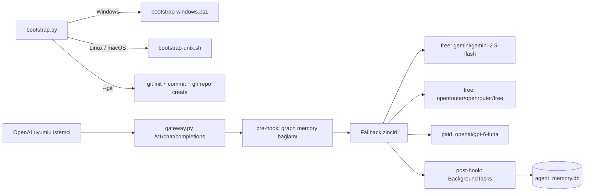

# middle-agentic

Windows, Linux (Ubuntu/Debian/Raspberry Pi OS/Fedora/RHEL) ve macOS makineleri tek komutla
**SSH ile yönetilebilir worker node**'lara dönüştüren ve üzerlerinde OpenAI uyumlu bir
**Middle-Agent Gateway** çalıştıran cross-platform otomasyon reposu.

- **Bootstrap**: OpenSSH sunucusu, firewall, kullanıcı, `authorized_keys` ve sıkı dosya izinleri, Python venv.
- **Gateway**: FastAPI + LiteLLM. Ücretsiz katmanlardan başlayıp kota bittiğinde ucuz ücretli katmana geçen otomatik fallback zinciri.
- **Graph Memory**: SQLite üzerinde node/edge tabanlı hafıza. İstek öncesinde bağlam enjekte eden bir pre-hook, yanıt gönderildikten sonra asenkron kayıt yapan bir post-hook.

## Mimari



| Dosya | Görev |
| --- | --- |
| `bootstrap.py` | İşletim sistemini algılar, uygun scripti çalıştırır (Windows'ta UAC ile yükseltir), `--git` ile repo kurar |
| `bootstrap-windows.ps1` | OpenSSH.Server, firewall, `sshuser`, `authorized_keys` + `administrators_authorized_keys`, icacls, DefaultShell |
| `bootstrap-unix.sh` | apt/dnf/yum/brew ile paketler, SSH servisi, `~/.ssh` 700/600, venv |
| `gateway.py` | FastAPI gateway, fallback zinciri, SQLite graph memory |

## Gereksinimler

- **Windows**: Windows 10 1809+ / Windows 11, yönetici yetkisi. Python sadece `bootstrap.py` ve gateway için gerekir.
- **Linux/macOS**: `bash`, `sudo`. Python 3.9+ eksikse script kendisi kurar.
- Bağlanacak makinenin (ör. MacBook) public key'i: `cat ~/.ssh/id_ed25519.pub`. Key yoksa `ssh-keygen -t ed25519` ile oluşturun.

## Hızlı Kurulum

### Windows (yönetici PowerShell)

Repo klonlanmadan, tek satırda:

```powershell
& ([scriptblock]::Create((irm https://raw.githubusercontent.com/galaxous/middle-agentic/main/bootstrap-windows.ps1))) -PublicKey "ssh-ed25519 AAAA... me@macbook"
```

> Düz `irm ... | iex` parametre geçiremez. Bu yüzden yukarıdaki `scriptblock` kalıbı kullanılır.

Parametreler:

```powershell
-UserName sshuser             # varsayılan: sshuser
-DefaultShell PowerShell      # PowerShell | GitBash | None
-Password (Read-Host -AsSecureString)   # verilmezse güçlü rastgele parola üretilip bir kez gösterilir
```

Repo klonlanmışsa:

```powershell
git clone https://github.com/galaxous/middle-agentic.git; cd middle-agentic
python bootstrap.py --pubkey "ssh-ed25519 AAAA... me@macbook" --shell GitBash
```

`ExecutionPolicy` engeline takılırsanız: `Set-ExecutionPolicy -Scope Process Bypass`.

### Linux / macOS / Raspberry Pi

Tek satırda:

```bash
curl -fsSL https://raw.githubusercontent.com/galaxous/middle-agentic/main/bootstrap-unix.sh | bash -s -- --pubkey "ssh-ed25519 AAAA... me@macbook"
```

> Pipe ile çalıştırıldığında venv, mevcut dizinde `requirements.txt` varsa kurulur. Tam kurulum için repoyu klonlayın.

Repo ile:

```bash
git clone https://github.com/galaxous/middle-agentic.git && cd middle-agentic
python3 bootstrap.py --pubkey "ssh-ed25519 AAAA... me@macbook"
# veya doğrudan
./bootstrap-unix.sh --pubkey "ssh-ed25519 AAAA..." [--skip-packages] [--skip-venv]
```

### Bağlantı testi

```bash
ssh sshuser@<windows-ip>      # Windows worker
ssh <kullanici>@<linux-ip>    # Linux / macOS
```

## Middle-Agent Gateway

```bash
cp .env.example .env          # anahtarları doldurun
./venv/bin/uvicorn gateway:app --host 0.0.0.0 --port 8000      # Windows: .\venv\Scripts\uvicorn ...
```

> `0.0.0.0` ile LAN'a açıyorsanız `.env` içinde `GATEWAY_API_KEY` tanımlayın. Aksi halde ağdaki herkes sizin API anahtarlarınızla istek atabilir.

| Endpoint | Açıklama |
| --- | --- |
| `GET /health` | Zincirdeki katmanların hazır olup olmadığı ve hafıza istatistikleri |
| `GET /v1/models` | OpenAI formatında model listesi |
| `POST /v1/chat/completions` | OpenAI uyumlu chat (v1'de `stream=false`) |

```bash
curl -s http://localhost:8000/v1/chat/completions \
  -H "Content-Type: application/json" \
  -H "Authorization: Bearer $GATEWAY_API_KEY" \
  -H "X-Session-Id: macbook-m4" \
  -d '{"model": "middle-agent", "messages": [{"role": "user", "content": "Merhaba!"}]}' -i
```

Yanıt header'ları:

- `X-Gateway-Model`: isteği gerçekte cevaplayan model.
- `X-Gateway-Tier`: `free` / `paid`.
- `X-Gateway-Session`: kullanılan oturum kimliği.
- `X-Gateway-Attempts`: denenen katman sayısı.

Tüm katmanlar başarısız olursa `503` döner ve gövdede her denemenin sebebi listelenir.

OpenAI SDK ile:

```python
from openai import OpenAI

client = OpenAI(base_url="http://localhost:8000/v1", api_key="<GATEWAY_API_KEY veya herhangi bir değer>")
reply = client.chat.completions.create(
    model="middle-agent",
    messages=[{"role": "user", "content": "Selam"}],
    extra_headers={"X-Session-Id": "macbook-m4"},
)
```

### Fallback zinciri

`MODEL_CHAIN` ortam değişkeni ile kod değiştirmeden yönetilir:

```env
MODEL_CHAIN=free:gemini/gemini-2.5-flash,free:openrouter/openrouter/free,paid:openai/gpt-6-luna
```

Zincirin işleyişi:

- Katmanlar sırayla denenir.
- API anahtarı tanımlı olmayan sağlayıcılar atlanır.
- Şu hatalarda bir sonraki katmana geçilir: rate limit / kota, servis kesintisi, bağlantı hatası, timeout, kimlik doğrulama hatası, bulunamayan model, geçersiz istek.
- İstemcinin gönderdiği `model` alanı yok sayılır. Hangi modelin cevapladığı `X-Gateway-Model` header'ından görülür.
- İstemci parametrelerinden yalnızca güvenli olanlar sağlayıcıya iletilir (`temperature`, `max_tokens`, `tools` vb.). `api_key` ve `api_base` gibi alanlar düşürülür.

### Graph Memory

`agent_memory.db` (SQLite, WAL modu):

```text
nodes(id, session_id, role, content, metadata, created_at)
edges(src_id, dst_id, relation, created_at)   -- relation: follows | responded_by
```

- **pre-hook**: Oturumun son `MEMORY_RECENT_LIMIT` düğümü ile son kullanıcı mesajındaki anahtar kelimelerle eşleşen düğümler alınır. Eşleşen düğümlerin `responded_by` komşuları da eklenir (tek adımlı graph genişletmesi). Sonuç, istemcinin system prompt'larından hemen sonra bir `system` mesajı olarak enjekte edilir.
- **post-hook**: Yanıt gönderildikten sonra `BackgroundTasks` ile kullanıcı ve asistan düğümleri ile kenarlar yazılır. Hafıza hataları isteği asla bozmaz.
- Oturum `X-Session-Id` header'ı ile seçilir (varsayılan: `default`). İstek bazında kapatmak için `X-Memory: off` gönderin, tamamen kapatmak için `MEMORY_ENABLED=false` ayarlayın.

## Git ve GitHub

```bash
python3 bootstrap.py --skip-bootstrap --git
```

Bu komut şunları yapar:

- Proje dizininde `.git` yoksa `git init -b main` çalıştırır. Kontrol bilinçli olarak `.git` klasörüne bakılarak yapılır, böylece üst dizindeki bir repo yanlışlıkla kullanılmaz.
- `git add .` ve `chore: initial bootstrap & middle-agent gateway setup` mesajıyla commit atar.
- `gh` kurulu ve oturum açıksa `gh repo create galaxous/middle-agentic --public --source . --remote origin --push` çalıştırır. Değilse aynı komutu talimat olarak yazdırır.

İlk yayın MCP üzerinden yapıldıysa yerel commit uzak commit'ten farklı olabilir. Hizalamak için:

```bash
git remote add origin https://github.com/galaxous/middle-agentic.git   # yoksa
git fetch origin && git reset --soft origin/main && git branch -u origin/main
```

## Sorun Giderme

**Windows'ta key olmasına rağmen parola soruluyor (`Permission denied (publickey)`):**

- Kullanıcı `Administrators` grubundaysa sshd, `C:\ProgramData\ssh\administrators_authorized_keys` dosyasını okur. `~\.ssh\authorized_keys` dikkate alınmaz. Script her iki dosyayı da yazar.
- Dosya izinleri yalnızca `Administrators` ve `SYSTEM` için olmalıdır. Kontrol için: `icacls C:\ProgramData\ssh\administrators_authorized_keys`.
- Dosya UTF-8 **BOM'suz** olmalıdır. PowerShell 5.1'deki `echo key > file` komutu UTF-16 yazar ve sshd anahtarı tanımaz. Script dosyayı .NET üzerinden BOM'suz yazar.
- Dosyanın uzantısı olmamalıdır (`authorized_keys.txt` değil). Script `.txt` kalıntılarını siler.
- Log'lar: `Get-WinEvent -LogName OpenSSH/Operational -MaxEvents 20`.

**Linux/macOS'ta `Permission denied`:**

- `~/.ssh` izni `700`, `authorized_keys` izni `600` olmalıdır. Ev dizini de başkaları tarafından yazılabilir olmamalıdır: `chmod go-w ~`.

**macOS'ta Remote Login açılmadı:**

- Terminale Full Disk Access verin veya System Settings > General > Sharing > Remote Login yolundan elle açın.

**Gateway `503 all_tiers_failed` dönüyor:**

- Gövdedeki `attempts` listesine bakın. Muhtemelen API anahtarı tanımlı değil (`skipped`) veya model adı sağlayıcıda yok (`NotFoundError`). `/health` endpoint'i her katmanın durumunu gösterir.
