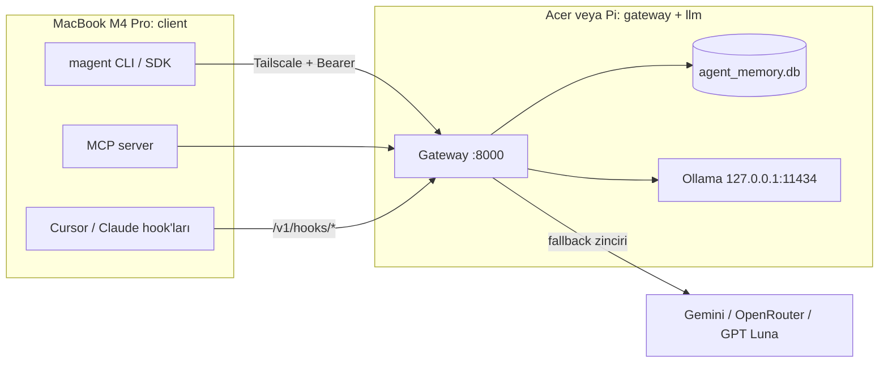

# middle-agentic

Windows, Linux (Ubuntu/Debian/Raspberry Pi OS/Fedora/RHEL) ve macOS cihazlarını tek komutla **middle-agent node**'larına dönüştüren cross-platform repo. Her cihaz aynı repoyu kurar ve rollerini seçer:

| Rol | Ne yapar |
| --- | --- |
| `gateway` | OpenAI uyumlu API, fallback zinciri, graph memory, hafıza ve hook API'leri. Arka plan servisi olarak çalışır. |
| `llm` | Yerel model sunucusu (varsayılan Ollama; llama.cpp, vLLM ve LM Studio da seçilebilir). Yalnızca `127.0.0.1` üzerinde dinler. |
| `client` | Başka node'lara prompt ve hook gönderen taraf: `magent` CLI, Python SDK, MCP server, Cursor/Claude Code hook'ları. |

Cihazlar birbirini **Tailscale** ağı (tailnet) üzerinden bulur. İstekler `Bearer` API anahtarıyla korunur.

## Mimari



Varsayılan zincir önce bulutu dener: `gemini-2.5-flash` > `openrouter/free` > yerel Ollama > `gpt-6-luna`. Anahtarı tanımlı olmayan bulut katmanları ve çalışmayan ya da modeli indirilmemiş yerel katmanlar otomatik atlanır.

## Hızlı kurulum

Kurulum iki adım ve repo indirmeyi gerektirmez. Her şey sürüm etiketindeki (v0.4.0) betiklerden yapılır.

**Önce hazırlayın:** her cihazın SSH public key'i (`cat ~/.ssh/id_ed25519.pub`; yoksa `ssh-keygen -t ed25519`) ve bir Tailscale auth key'i ([admin panelinden](https://login.tailscale.com/admin/settings/keys)). Auth key verilmezse adım 1'den sonra `tailscale up` ile elle bağlanın.

### Adım 1: ağ ve SSH (repo gerekmez)

Bu adım SSH'ı açar, Tailscale'i kurup ağa katar, gerekirse Ollama'yı kurar. Gateway servisine dokunmaz.

macOS, Linux ve Raspberry Pi:

```bash
# gateway Mac (Tailscale + SSH + yerel model)
curl -fsSL https://raw.githubusercontent.com/galaxous/middle-agentic/v0.4.0/scripts/bootstrap-unix.sh | bash -s -- \
  --pubkey "$(cat ~/.ssh/id_ed25519.pub)" --roles gateway,llm --ts-authkey tskey-auth-... \
  --skip-venv --skip-service

# istemci (Tailscale + SSH, yerel model yok)
curl -fsSL https://raw.githubusercontent.com/galaxous/middle-agentic/v0.4.0/scripts/bootstrap-unix.sh | bash -s -- \
  --pubkey "$(cat ~/.ssh/id_ed25519.pub)" --roles client --ts-authkey tskey-auth-... \
  --skip-venv --skip-service
```

Windows (yönetici PowerShell):

```powershell
& ([scriptblock]::Create((irm https://raw.githubusercontent.com/galaxous/middle-agentic/v0.4.0/scripts/bootstrap-windows.ps1))) `
  -PublicKey "ssh-ed25519 AAAA... me@macbook" -Roles gateway,llm -TsAuthKey tskey-auth-... -SkipService
```

> Raspberry Pi'de Ollama 64-bit OS ister. 32-bit sistemde `llm` rolünü kaldırın; cihaz bulut katmanlarıyla gateway olarak çalışır.
> Windows betiği Ollama'yı kullanıcı oturumu açıldığında başlatır; başsız bir worker'da otomatik oturum açmayı etkinleştirin.

### Adım 2: magent (repo gerekmez)

**Gateway** (macOS, Linux, Raspberry Pi):

```bash
curl -fsSL https://github.com/galaxous/middle-agentic/releases/download/v0.4.0/install.sh | sh -s -- --role gateway
```

Mevcut bir gateway'den taşıyorsanız önce `agent_memory.db`, `.env` ve `config.yaml` dosyalarını bir klasöre kopyalayın, sonra `MAGENT_DATA_DIR=~/magent-data sh install.sh --role gateway` ile çalıştırın. Komut servisi durdurur, veriyi ev dizinine taşır, servisi kurulu sürümle başlatır ve `/health` yanıtını bekler.

**Gateway** (Windows, PowerShell):

```powershell
$env:MAGENT_ROLE = 'gateway'; irm https://github.com/galaxous/middle-agentic/releases/download/v0.4.0/install.ps1 | iex
```

**İstemci** (MacBook, Linux, Raspberry Pi): adres ve anahtar sorulur, doğrulanır, sonra kurulur. Hiçbir şey doğrulanmadan yazılmaz.

```bash
curl -fsSL https://github.com/galaxous/middle-agentic/releases/download/v0.4.0/install.sh | sh
```

**İstemci** (Windows):

```powershell
irm https://github.com/galaxous/middle-agentic/releases/download/v0.4.0/install.ps1 | iex
```

### Güncelleme

Yeni bir sürüm çıktığında aynı kurulum komutunu yeni etiketle yeniden çalıştırın (ör. `v0.4.1`). Gateway'de bu, paketi yeniler ve servisi yeniden başlatır; veri dosyalarına dokunmaz. İstemcide adres ve anahtar tekrar sorulur; mevcut anahtar aynıysa Enter ile geçebilirsiniz.

Yalnızca gateway'de çalışan bir kurulum için manuel yol: `pipx install --force <yeni wheel>` ardından `magent service install`.

### Repo ile geliştirme

Kodu geliştirmek için repo gerekir:

```bash
git clone https://github.com/galaxous/middle-agentic.git && cd middle-agentic
python3 -m venv venv && ./venv/bin/pip install -e ".[dev]"
./venv/bin/pytest
```

Repo'dan kurulum (`bootstrap.py`) hâlâ çalışır; ancak repo'nun silinmesi gereken kurulumlarda yukarıdaki sürüm kurulumunu tercih edin.

### Anahtarlar ve kapsamlar

Gateway'in her istemci için ayrı anahtarı vardır ve her anahtarın yalnızca ihtiyaç duyduğu kapsamları olur:

| Kapsam | Ne yapar | Varsayılan |
| --- | --- | --- |
| `memory:read` | Hafıza araması, bağlam, oturum listesi | evet |
| `memory:write` | Kayıt yazma, hook'lar | evet |
| `models` | Sohbet ve MCP `ask` (provider maliyeti) | hayır |
| `memory:delete` | Uzaktan `forget` | hayır |
| `admin` | Salt okunur yönetim uçları: `/admin/usage`, `/admin/budget`, `/admin/models` | hayır |

```bash
magent key create macbook-cursor --scopes memory:read,memory:write,models
magent key set-scopes macbook-cursor --scopes memory:read,memory:write   # kapsamı daralt
magent key create client-admin --scopes memory:read,memory:write,models,admin   # kullanım ve bütçe komutları için
```

Hook'lar okuma ve yazma kapsamı ister; Cursor'un `ask` aracı `models` ister.

Her anahtarın ayrıca bir süresi (varsayılan 90 gün, `--expires-days 0` süresiz), isteğe bağlı kotaları (`--per-minute`, `--daily-limit`) vardır. Süresi dolan anahtar 401, kota aşımı 429 alır:

```bash
magent key renew macbook-cursor --expires-days 90
magent key set-limits macbook-cursor --daily-limit 2000 --per-minute 60
magent key audit macbook-cursor --hours 24     # kim, ne zaman, hangi yol/araç, hangi sonuç
```

Her HTTP isteği (`/health` hariç) `api_audit` tablosuna yazılır. Kimliği doğrulanamayan denemeler de anahtar `-` ile kaydedilir.

**Bellek silme (soft delete):** `forget` kayıtları silmez; silinen kayıt, işlemi yapan anahtar ve gerekçe ile saklanır. Aramalar ve bağlam silinmiş kayıtları görmez. Gateway makinesinde incelemek için:

```bash
magent memory deleted --session <oturum>
magent memory purge --older-than-days 365 --yes   # saklama süresi dolanları kalıcı siler
``` Gateway makinesinde `magent key create <ad>` anahtarı bir kez gösterir; istemcide `magent token set gateway` ile Keychain'e (macOS) ya da DPAPI'ye (Windows) yazılır. Bu depo ortam değişkenlerinden önce kullanılmaz; gerekirse `MAGENT_API_KEY` ortamdan okunur.

Gateway'de anahtar listesi ve iptal:

```bash
magent key list
magent key revoke <ad>      # iptal anında etkili olur
```

GUI uygulamaları (Cursor, VS Code) terminal profilini okumadığı için anahtarı oturum ortamına taşıyan LaunchAgent'ı bir kez kurun (yalnızca macOS):

```bash
./venv/bin/magent token login-env           # her girişte Keychain'den MAGENT_API_KEY'i ayarlar
./venv/bin/magent token login-env-remove    # kaldırmak için
```

### Bootstrap bayrakları

| `bootstrap.py` | Açıklama |
| --- | --- |
| `--roles gateway,llm,client` | Kurulacak roller (varsayılan: hepsi) |
| `--ts-authkey KEY` | Tailscale'e otomatik katılım |
| `--model qwen2.5:3b` | `llm` rolünün modeli |
| `--user`, `--shell` | Windows SSH kullanıcısı ve DefaultShell (`PowerShell`, `GitBash`, `None`) |
| `--skip-packages`, `--skip-tailscale`, `--skip-llm`, `--skip-venv`, `--skip-service` | İlgili adımı atlar |
| `--git [--no-push]` | `git init`, commit ve `gh repo create` |

## Yapılandırma

| Dosya | İçerik |
| --- | --- |
| `config.yaml` | Node adı, roller, zincir, peer listesi. `magent setup` yazar; şablon için `config.example.yaml` dosyasına bakın. |
| `.env` | API anahtarları ve host'a özel değerler. Şablon: `.env.example`. |

Ortam değişkenleri her zaman `config.yaml` değerlerinin önüne geçer. Eski `MODEL_CHAIN` değişkeni hâlâ desteklenir ve tanımlıysa `chain` bölümünün yerine kullanılır.

### API anahtarları

Sağlayıcı anahtarları yalnızca **gateway** node'unun `.env` dosyasına yazılır, çünkü modelleri çağıran o makinedir. İstemci cihazlara yalnızca gateway anahtarı gerekir (`magent token set gateway`). Anahtarı tanımlı olmayan katman zincirde atlanır.

| Değişken | Nereden alınır | Not |
| --- | --- | --- |
| `GEMINI_API_KEY` | [Google AI Studio](https://aistudio.google.com/apikey) | Ücretsiz katmanı var (dakikalık ve günlük limitli). |
| `OPENROUTER_API_KEY` | [OpenRouter > Keys](https://openrouter.ai/settings/keys) | Yalnızca adı `:free` ile biten modeller ücretsiz; [ücretsiz model listesi](https://openrouter.ai/models?max_price=0). |
| `OPENAI_API_KEY` | [OpenAI Platform > API keys](https://platform.openai.com/api-keys) | Ücretli (`luna` katmanı). |
| `ANTHROPIC_API_KEY` | [Anthropic Console > API keys](https://console.anthropic.com/settings/keys) | Ücretli; zincire `runtime: anthropic` ile eklenir. |
| Tailscale auth key | [Tailscale admin > Keys](https://login.tailscale.com/admin/settings/keys) | `bootstrap.py --ts-authkey` için. |

Anahtarı ekledikten sonra gateway servisini yeniden başlatın (macOS: `launchctl kickstart -k gui/$(id -u)/com.galaxous.magent-gateway`) ve `magent health` ile katmanın `"available": true` olduğunu kontrol edin.

#### Anahtarları işletim sistemi deposunda tutmak (`magent token`)

Düz metin anahtarları `~/.zprofile` veya `.env` içinde tutmak yerine `magent token` ile İşletim sistemi deposuna yazın. Değer hiçbir zaman komut satırı argümanı olarak geçmez ve profil dosyalarına yazılmaz.

| Ortam | Depo | Profil dosyası |
| --- | --- | --- |
| macOS | Login Keychain (`security`), servis `<sağlayıcı>-api-key` | `~/.zprofile` (zsh), `~/.bash_profile` (bash) |
| Windows | `%LOCALAPPDATA%\middle-agentic\secrets\*.dpapi`, DPAPI (yalnızca bu Windows kullanıcısı çözebilir) | `Documents\PowerShell\Microsoft.PowerShell_profile.ps1` |

Sağlayıcılar: `anthropic`, `openai`, `gemini`, `openrouter`.

```bash
# macOS
./venv/bin/magent token set openai              # gizli prompt
./venv/bin/magent token list                    # set / missing, değer göstermez
./venv/bin/magent token install-shell --shell zsh --dry-run
./venv/bin/magent token install-shell --shell zsh
```

```powershell
# Windows
python -m middle_agentic token set openai
python -m middle_agentic token install-shell --shell powershell --dry-run
python -m middle_agentic token install-shell --shell powershell
```

- `install-shell` profilin sonuna işaretli bir blok ekler. Bloğun dışındaki satırlara dokunmaz. Düz metin bir `export`/`$env:` satırı varsa uyarır, değerini yazdırmaz; o satırı kendiniz silmelisiniz. Değişiklikten önce `.bak` alınır.
- Komut tekrar çalıştırılabilir; değişiklik yoksa `no change` yazar.
- `apiKeyHelper` için `magent token get anthropic` yeterlidir (değeri stdout'a yazar).
- **Sınır:** macOS'ta VS Code'u Dock'tan, Windows'ta Başlat menüsünden açtığınızda profil dosyaları okunmaz. Bu uygulamalarda anahtar gerekiyorsa uygulamanın kendi yapılandırmasını (ör. `apiKeyHelper`) kullanın ya da uygulamayı terminalden başlatın.
- Gateway anahtarları hâlâ `.env` dosyasından okur; `magent token` bu okumayı değiştirmez.

Zincir örneği:

```yaml
chain:
  - { name: gemini-flash,    tier: free,  runtime: gemini,     model: gemini-2.5-flash }
  - { name: openrouter-free, tier: free,  runtime: openrouter, model: openrouter/free }
  - { name: local,           tier: local, runtime: ollama,     model: qwen2.5:3b }
  - { name: luna,            tier: paid,  runtime: openai,     model: gpt-6-luna }
```

| `runtime` | LiteLLM karşılığı | Kullanılabilirlik kontrolü |
| --- | --- | --- |
| `ollama` | `ollama_chat/` | `GET /api/tags` ve modelin indirilmiş olması |
| `llamacpp` | `openai/` + `api_base` | `GET /v1/models` |
| `vllm` | `hosted_vllm/` | `GET /v1/models` |
| `lmstudio` | `lm_studio/` | `GET /v1/models` |
| `openai`, `anthropic`, `gemini`, `openrouter`, `groq`, `mistral`, `deepseek` | aynı adlı önek | API anahtarı ortam değişkeni |
| `litellm` | model dizesi olduğu gibi | yok |

Yerel OpenAI uyumlu sunuculara gerçek `OPENAI_API_KEY` asla gönderilmez; bunun yerine sabit bir yer tutucu anahtar kullanılır.

## Kullanım ve günlük bütçe

Gateway her model denemesini kaydeder: anahtar, iş etiketi, katman, token sayıları, maliyet, gecikme ve sonuç. Başarısız denemeler 0 maliyetle kaydedilir. Akış (stream) istekleri de kaydedilir.

Günlük harcama sınırı, otonom işçilerin kontrolsüz harcamasını önlemek içindir. Varsayılan **günde $1**; gün, gateway makinesinin yerel gününe göre sıfırlanır.

```yaml
# config.yaml (gateway makinesi)
budget:
  daily_usd: 1.0          # 0 = sınır yok
  on_exceed: downgrade    # downgrade: yalnız ücretsiz/yerel katmanlar çalışır | block: 429 döner
chain:
  - { name: luna, tier: paid, runtime: openai, model: gpt-6-luna, price_in: <USD/1M>, price_out: <USD/1M> }
```

- `price_in` / `price_out`: katmanın USD / 1M token fiyatı. Tanımlıysa LiteLLM'in fiyat tablosunun önüne geçer; yeni çıkan modeller için buradan girin.
- Sınır dolduğunda `downgrade` modunda ücretli katmanlar atlanır; `block` modunda istek 429 (`budget_exceeded`) alır ve sağlayıcıya gitmez.
- İstemci `--budget` (ya da `X-Budget-USD` başlığı) ile tek bir isteğin sınırını düşürebilir; yükseltemez.
- Yanıt başlığı `X-Gateway-Budget` (`ok`, `downgraded`, `blocked`) hangi modun uygulandığını gösterir.

Bütçe ve katman ayarları çalışırken değiştirilebilir: `magent budget set`, `magent models disable|set|reorder` ya da `/admin/*` uçları. Değişiklik bir sonraki istekte etkili olur; gateway yeniden başlatılmaz. `config.yaml` hiç yeniden yazılmaz; değişiklikler gateway'in veritabanında tutulur ve `reset` ile silinir.

### Eşzamanlılık

Her katmanın aynı anda çalışan istek sınırı (`max_concurrency`) vardır. Yerel katmanlarda varsayılan 1'dir, çünkü tek bir model bir makinede bir istekle daha verimli çalışır. Bulut katmanlarında sınır yoktur. Sınır doluysa istek `queue_wait` saniye (varsayılan 30) bekler; yer açılmazsa zincir bir sonraki katmana geçer ve atlanan katman `saturated` olarak işaretlenir. Akış (stream) isteği, akış bitene kadar yerini tutar.

```bash
magent models set local --concurrency 2 --queue-wait 5
magent models set luna --concurrency 0     # 0 = sınır yok
```

**Anahtar başına bütçe (isteğe bağlı, varsayılan kapalı):** Bir anahtara kendi günlük sınırını verebilirsiniz. Bu anahtar için genel `budget` yerine geçer; diğer anahtarlar etkilenmez. Hiç verilmezse genel bütçe geçerli kalır.

```bash
magent key create worker-news --scopes memory:read,memory:write,models --budget 0.20 --on-exceed downgrade
magent key set-budget worker-news --budget 0.5           # sonradan değiştir
magent key set-budget worker-news --clear-budget         # genel bütçeye dön
magent budget --key worker-news                          # o anahtarın harcaması ve sınırı (admin anahtarı gerekir)
magent budget set --key worker-news --daily 0.5 --on-exceed block
```

Sınırlar: bütçe, istek bittikten sonra kaydedilen maliyete göre denetlenir; bu yüzden bir istek kalan bütçeden pahalıysa yine tamamlanabilir. Fiyatı bilinmeyen ücretli modellerin maliyeti 0 kaydedilir (`cost_src: unknown`); bunları `price_in` / `price_out` ile tanımlayın. Ücretsiz katmanlar da LiteLLM'in liste fiyatıyla sayılır.

### Katman kontrolleri

Her katman için ek sınırlar tanımlanabilir (hepsi isteğe bağlıdır):

| Alan | Anlamı |
| --- | --- |
| `daily_request_cap` | Günlük deneme sayısı; sınıra ulaşınca katman atlanır. `reset_tz` günün sınırını belirler (ör. Gemini için `America/Los_Angeles`). |
| `cooldown_seconds` | Hız sınırı (429) alan katman bu süre boyunca denenmez (varsayılan 900 sn). |
| `supports_tools: false` | Araç çağrısı içeren istekler bu katmana gönderilmez. |
| `context_window` | İstem bu boyutu aşıyorsa katman atlanır. |

Atlanan her katman, yanıtta `attempts` içinde nedeniyle birlikte görünür (ör. `cooling down after a rate limit`, `daily request cap reached`).

**Profiller:** `model` alanına `profile:cheap-first` (önce yerel ve ücretsiz, sonra fiyata göre) veya `profile:quality-first` (önce en pahalı) yazılabilir.

**Katman testi:** `magent models test <katman>` katmanı zincir ve bütçe dışında tek bir kısa istekle sınar; gecikme, token, maliyet ve kaynak (`tier`, `litellm`, `unknown`) gösterir. Yeni bir model eklerken fiyatını ve kimliğini bununla doğrulayın.

## İstemci araçları

### CLI

```bash
magent nodes                                   # yerel + config peer'ları + Tailscale node'ları
magent ask "Bu hatayı açıkla" --node acer      # zincir (auto)
magent ask "..." --node acer --model local --stream
magent ask "..." --model free --no-memory      # yalnızca free katmanları, hafızasız
magent hook record "Postgres'e geçmeye karar verdik" --role decision
magent hook context "veritabanı kararı"
magent hook forget "deneme sorusu" [--id ID] [--role user] [--yes]   # --yes olmadan yalnızca listeler
magent health --node acer
magent ask "..." --job daily-digest --budget 0.05   # iş etiketi ve bu istek için bütçe sınırı
magent usage [--by tier|key|job|day] [--days N] [--json]   # harcama (admin anahtarı gerekir)
magent budget [--json]                              # bugünkü harcama ve günlük sınır (admin anahtarı gerekir)
magent budget set --daily 0.5 [--on-exceed block]   # sınırı yeniden başlatmadan değiştir
magent budget reset                                 # config.yaml'daki değere dön
magent models [--json]                              # sıra, durum, fiyat, çalışan/limit (admin anahtarı gerekir)
magent models disable|enable <katman>               # katmanı zincirden çıkar / geri koy
magent models set <katman> [--model M] [--timeout S] [--price-in X] [--price-out Y] [--concurrency N] [--queue-wait S]
magent models reorder <katman1> <katman2> ...       # zincir sırasını değiştir (listelenmeyenler sonda kalır)
magent models reset [<katman>...] [--all]           # config.yaml'daki haline dön
magent models test <katman>                         # tek kısa istekle katmanı sına (maliyet ve gecikme gösterir)
magent budget --key <ad> | set --key <ad> --daily X | reset --key <ad>   # anahtar başına bütçe
magent llm pull qwen2.5:7b | list | status
magent serve                                   # gateway'i ön planda çalıştır
magent service install | uninstall | status
magent integrate cursor | claude [--scope project] [--url http://acer:8000]
magent integrate codex | antigravity [--scope project] [--url URL]   # hook + MCP
magent integrate continue [--scope project]                         # yalnızca MCP
magent rules install | remove | show [--tool cursor|claude|codex|antigravity|continue|all] [--project DIR]
magent token set | get | delete <provider> | list | env [--shell zsh|bash|powershell]
magent token install-shell [--shell zsh|bash|powershell] [--profile FILE] [--dry-run]
magent mcp                                     # MCP server (stdio)
```

`--node` şu değerleri kabul eder: `config.yaml` içindeki bir peer adı, bir Tailscale cihaz adı, bir URL veya `local`. Verilmezse `MAGENT_URL`, ardından `client.default_node` ve en son yerel gateway kullanılır.

`--model` şu değerleri kabul eder: `auto` (tüm zincir), bir katman adı (`local`, `luna`) veya bir etiket (`free`, `local`, `paid`). Bu bir allowlist'tir; tanımsız model adları `400` döner.

Hafıza oturumu varsayılan olarak bulunduğunuz projeye bağlıdır. Hook'lar ve MCP server da aynı oturumu kullanır, `--session` ile değiştirilebilir.

### Python SDK

```python
from middle_agentic.client import MiddleAgentClient

with MiddleAgentClient(node="acer", session_id="research") as client:
    result = client.ask("Fallback zinciri nedir?", model="local")
    print(result.text, result.tier_name, result.model)

    for delta in client.stream("Bir haiku yaz"):
        print(delta, end="", flush=True)

    client.record_event("Release her salı çıkar", role="fact")
    print(client.context("release günü")["context"])
```

### OpenAI uyumlu kullanım

```python
from openai import OpenAI

client = OpenAI(base_url="http://acer:8000/v1", api_key="<magent key create ile üretilen anahtar>")
reply = client.chat.completions.create(
    model="auto",
    messages=[{"role": "user", "content": "Selam"}],
    extra_headers={"X-Session-Id": "macbook-m4"},
)
```

### Cursor ve Claude Code

```bash
magent integrate cursor     # ~/.cursor/hooks.json + ~/.cursor/mcp.json
magent integrate claude     # ~/.claude/settings.json + claude mcp add (CLI yoksa ~/.claude.json)
cd ~/projem && magent rules install   # .cursor/rules/memory.mdc + CLAUDE.md içine hafıza bloğu
```

### Gateway MCP endpoint'i (`/mcp`)

Gateway, MCP protokolünü streamable HTTP üzerinden `/mcp` adresinde de sunar. Araçlar (`ask`, `memory_search`, `memory_record`, `list_nodes`) gateway'in kendi bellek ve model zincirini kullanır; istemcinin yerel Python kurmasına gerek yoktur.

```text
URL:     http://<gateway>:8000/mcp/
Header:  Authorization: Bearer <magent key create ile üretilen anahtar>
```

- Her istek, gateway'in anahtar deposundaki aktif bir anahtarla gelmelidir (`magent key create`). Paylaşılan tek bir `GATEWAY_API_KEY` yoktur.
- MCP SDK'nın DNS rebinding kontrolü kapalıdır; Tailscale adından erişimi engellemesin diye. Güvenlik bearer anahtarla sağlanır.
- Yerel stdio sunucusu (`magent mcp`) değişmedi.

### Codex, Antigravity ve Continue

| Araç | Hook (`magent integrate`) | MCP | Kural (`magent rules install`) |
| --- | --- | --- | --- |
| Codex CLI | `~/.codex/hooks.json`: `SessionStart`, `UserPromptSubmit`, `Stop` | `~/.codex/config.toml` içinde yönetilen blok | `AGENTS.md` blok |
| Antigravity | `~/.gemini/config/hooks.json`: `SessionStart`, `PreInvocation` | `~/.gemini/config/mcp_config.json` | `AGENTS.md` blok (Codex ile aynı dosya) |
| Continue (VS Code) | yok | `<proje>/.continue/mcpServers/middle-agentic.yaml` | `.continue/rules/middle-agentic-memory.md` |

`--scope project` ile hook ve MCP dosyaları projenin `.codex/` ve `.agents/` klasörlerine yazılır. Codex projeleri yalnızca güvenilirse yüklenir.

```bash
magent integrate codex           # hooks.json + config.toml
magent integrate antigravity     # mcp_config.json + hooks.json
magent integrate continue --scope project --project ~/projem
cd ~/projem && magent rules install   # tüm araçların kuralları: CLAUDE.md, AGENTS.md, .continue/rules/
```

Codex, non-managed hook'ları yalnızca güvenildikten sonra çalıştırır. `magent integrate codex`'ten sonra CLI'da `/hooks` açıp middle-agentic hook'larını bir kez güvenin; aksi halde atlanırlar.

Antigravity hook'ları olay adını payload'da taşımaz; kurulum her olay için `magent_hook.py antigravity --event <Olay>` çağırır. Antigravity `PreInvocation` payload'ında asistan yanıtı olmadığı için yanıtlar kaydedilmez; `PreInvocation` yalnızca turun ilk çağrısında kullanıcı mesajını kaydeder ve ilgili hafızayı `ephemeralMessage` olarak enjekte eder.

`magent integrate`, `--url` verilmezse `MAGENT_URL`'i, ardından `MAGENT_DEFAULT_NODE`'u kurulum anında çözer (ör. Tailscale IP'si) ve hook komutuna `--url` olarak yazar. Hook scripti de `--url` yoksa aynı sırayı izler.

`magent rules install`, agent'a her iş öncesinde `memory_search`, karar ve bilgiler için de `memory_record` (`role: decision | fact | note`) çağırmasını söyleyen kuralları projeye yazar. Kural, projenin mutlak yolunu `project_dir` olarak içerir. Böylece MCP server hangi dizinden başlatılırsa başlatılsın hook'larla aynı hafızayı kullanır. `CLAUDE.md`'deki mevcut içerik korunur; yalnızca işaretli blok eklenir ya da güncellenir.

| Araç | Hook | Davranış |
| --- | --- | --- |
| Cursor | `sessionStart` | Projenin son hafızası `additional_context` olarak eklenir |
| Cursor | `beforeSubmitPrompt` | Prompt kaydedilir (her zaman `continue: true`) |
| Cursor | `afterAgentResponse` | Yanıt kaydedilir |
| Claude Code | `SessionStart` | Projenin son hafızası `additionalContext` olarak eklenir |
| Claude Code | `UserPromptSubmit` | Prompt'la ilgili hafıza `additionalContext` olarak eklenir, ardından prompt kaydedilir |
| Claude Code | `Stop` | `last_assistant_message` kaydedilir |

Cursor bağlamı yalnızca oturum başında enjekte edebilir. Prompt bazlı bağlam için Cursor'daki agent MCP aracı `memory_search`'ü kullanır. MCP server şu araçları sunar: `ask`, `memory_search`, `memory_record`, `list_nodes`.

Hook scripti (`integrations/hooks/magent_hook.py`) yalnızca standart kütüphaneyi kullanır ve **fail-open** çalışır: gateway kapalıysa ya da yavaşsa nötr bir cevap döner ve agent hiç beklemez. Gizli anahtarlar yapılandırma dosyalarına yazılmaz; script bunları reponun `.env` dosyasından okur. Detaylar için [`integrations/README.md`](integrations/README.md) dosyasına bakın.

## Gateway API

| Endpoint | Açıklama |
| --- | --- |
| `GET /health` | Node adı, roller, zincirdeki katmanların durumu, hafıza istatistikleri. Kimlik doğrulama istemez; keşif için kullanılır. |
| `GET /v1/models` | `auto` ve zincirdeki katmanlar |
| `POST /v1/chat/completions` | OpenAI uyumlu chat. `stream: true` desteklenir. |
| `POST /v1/memory/context` | `{session_id, query, recent_limit?, related_limit?, important_limit?}` alır, bağlam düğümlerini ve hazır metni döner (pre-hook) |
| `POST /v1/memory/events` | `{session_id, role, content, metadata?, link_to?, relation?}` alır ve düğüm ekler (post-hook) |
| `POST /v1/memory/forget` | `{session_id, ids?, match?, role?, with_answers?, dry_run?}` ile düğüm siler. Varsayılan `dry_run: true`; eşleşen sorunun cevabı da silinir. |
| `GET /v1/memory/sessions` | Oturum listesi |
| `GET /v1/memory/sessions/{id}` | Oturumun grafı (düğümler ve kenarlar) |
| `POST /v1/hooks/{cursor\|claude}/{event}` | Aracın ham hook payload'unu alır, aracın beklediği formatta cevap döner |
| `GET /admin/usage` | Harcama ve istek sayısı. `by=tier\|key\|job\|day`, `days=N`. Yalnız `admin` kapsamı. |
| `GET /admin/budget` | Bugünkü harcama, günlük sınır ve politika. Yalnız `admin` kapsamı. |
| `GET /admin/models` | Katmanlar, sıra, fiyatlar, çalışan istek sayısı ve durum. Yalnız `admin` kapsamı. |
| `PATCH /admin/models/{ad}` | Katmanı değiştir: `enabled`, `model`, `timeout`, `price_in`, `price_out`, `max_concurrency`, `queue_wait`. Yalnız `admin`. |
| `DELETE /admin/models/{ad}` | Katmanın değişikliklerini sil (config.yaml'a dön). Yalnız `admin`. |
| `PUT /admin/models/order` | `{"names": [...]}` ile zincir sırasını ayarla. Yalnız `admin`. |
| `DELETE /admin/models/order` | Sırayı sıfırla. Yalnız `admin`. |
| `DELETE /admin/overrides` | Tüm katman değişikliklerini ve sırayı sıfırla (bütçeye dokunmaz). Yalnız `admin`. |
| `PUT /admin/budget` | `{"daily_usd": X, "on_exceed": "block"}` ile günlük sınırı değiştir. Yalnız `admin`. |
| `DELETE /admin/budget` | Bütçe değişikliğini sil (config.yaml'a dön). Yalnız `admin`. |

Chat yanıt header'ları:

- `X-Gateway-Node`: yanıtı veren node.
- `X-Gateway-Tier-Name` ve `X-Gateway-Tier`: katman adı ve etiketi.
- `X-Gateway-Model`: kullanılan model.
- `X-Gateway-Session`: hafıza oturumu.
- `X-Gateway-Attempts`: denenen katman sayısı.
- `X-Gateway-Budget`: günlük bütçe durumu (`ok`, `downgraded`, `blocked`).

İstek header'ları:

- `X-Session-Id`: hafıza oturumunu seçer.
- `X-Memory: off`: istek bazında hafızayı kapatır.
- `X-Job`: iş etiketi; `magent usage --by job` ile harcamayı işe göre gruplar.
- `X-Budget-USD`: bu isteğin bütçe sınırı (USD). Yalnız düşürür; geçersiz değer `400` döner.

Streaming'de fallback yalnızca ilk chunk gelmeden önce yapılır. Stream ortasında oluşan bir hata, SSE içinde `error` olayı olarak iletilir.

### Graph memory

`agent_memory.db` (SQLite, WAL modu):

```text
nodes(id, session_id, role, content, metadata, created_at)
edges(src_id, dst_id, relation, created_at)   -- follows | responded_by | özel ilişkiler
nodes_fts(node_id, content)                   -- FTS5 tam metin indeksi, trigger'larla güncel tutulur
```

- **Arama:** SQLite FTS5 ve BM25 sıralaması kullanılır. Uzun kelimeler önek olarak aranır (`veritabanında` sorgusu `veritabanı` kaydını bulur). `decision` ve `fact` düğümlerinin skoru 2 kat ağırlıklıdır, bu yüzden ham konuşmanın önüne geçerler. FTS5 yoksa `LIKE` aramasına düşülür. Eski veritabanları ilk açılışta otomatik indekslenir.
- **Oturum başı:** Sorgu yoksa son `memory.important_limit` (varsayılan 5) karar ve bilgi notu eklenir. Bağlam metninde bunlar "Project decisions and facts" başlığı altında, konuşmadan önce gelir.
- **pre-hook:** Oturumun son düğümleri alınır, ardından sorguyla eşleşen düğümler ve bunların `responded_by` komşuları eklenir. Sonuç, istemcinin system prompt'larından hemen sonra bir `system` mesajı olarak enjekte edilir.
- **post-hook:** Yanıt gönderildikten sonra arka planda yazılır. Hafıza hataları isteği asla bozmaz.

## Geliştirme

```bash
python3.12 -m venv venv && ./venv/bin/pip install -e ".[dev]"
./venv/bin/pytest
```

Testler LiteLLM'i mock'lar. SDK, MCP server ve hook scripti gerçek bir uvicorn sunucusuna karşı ayrı process'lerde test edilir. `uvicorn gateway:app` geriye uyumluluk için hâlâ çalışır.

### Değişiklik günlüğü

Her özellik, commit atılmadan önce [`docs/changelog/`](docs/changelog/README.md) altında tarihli bir dosyaya işlenir (`YYYY-MM-DD-konu.md`). Dosyalar Durum, Değişenler, Doğrulama ve Açık kalanlar bölümlerinden oluşur. Dizin ve kurallar için [`docs/changelog/README.md`](docs/changelog/README.md) dosyasına bakın.

## Sorun giderme

**Windows'ta key olmasına rağmen parola soruluyor (`Permission denied (publickey)`):**

- Kullanıcı `Administrators` grubundaysa sshd `C:\ProgramData\ssh\administrators_authorized_keys` dosyasını okur. Script her iki dosyayı da yazar.
- İzinler yalnızca `Administrators` ve `SYSTEM` için olmalıdır: `icacls C:\ProgramData\ssh\administrators_authorized_keys`.
- Dosya UTF-8 **BOM'suz** olmalı ve uzantısı olmamalıdır. Script her ikisini de garanti eder.
- Log'lar: `Get-WinEvent -LogName OpenSSH/Operational -MaxEvents 20`.

**Linux/macOS'ta `Permission denied`:** `~/.ssh` izni `700`, `authorized_keys` izni `600` olmalı ve ev dizini başkaları tarafından yazılabilir olmamalıdır (`chmod go-w ~`).

**`magent nodes` başka cihazı göstermiyor:**

- `tailscale status` ile iki cihazın da tailnet'te olduğunu doğrulayın.
- Gateway node'unda `config.yaml` içindeki `gateway.host` değeri `0.0.0.0` olmalıdır (`magent setup` bunu ayarlar).
- Firewall'un 8000 portunu tailnet'ten kabul ettiğini kontrol edin.
- `magent nodes --all` probe edilemeyen cihazları da listeler.

**Gateway `503 all_tiers_failed` dönüyor:**

- Gövdedeki `attempts` listesi her katmanın neden atlandığını gösterir: anahtar eksik, Ollama kapalı, model indirilmemiş ya da sağlayıcı hatası.
- `magent health` aynı bilgiyi gösterir.

**Servis çalışıyor ama `/health` cevap vermiyor:** LiteLLM'in yüklenmesi ilk açılışta 10-15 saniye sürer. Log'lar:

- macOS: `~/Library/Logs/magent-gateway.log`
- Linux: `journalctl --user -u magent-gateway -f`
